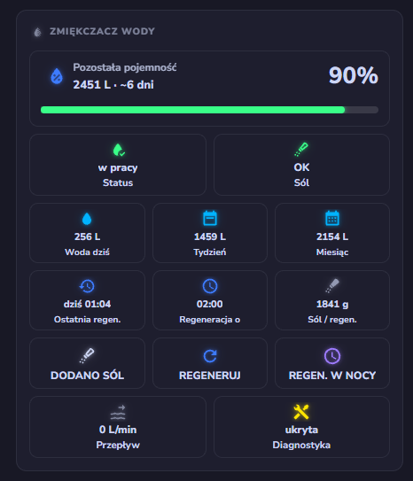

<p align="center">
  
</p>

<h1 align="center">Pentair ConnectMySoftener — Home Assistant</h1>

<p align="center">
  <a href="https://github.com/hacs/integration"></a>
  
  
  <a href="LICENSE"></a>
  <a href="https://buymeacoffee.com/jotuera"></a>
</p>

<p align="center"><strong>English</strong> · <a href="README.pl.md">Polski</a></p>

Home Assistant integration for **Pentair ConnectMySoftener** water softeners
(formerly **Erie** — same `erieapp` cloud backend, brand acquired by Pentair).

It talks to the official cloud API (`connectmysoftenerapi.pentair.eu`) exactly like the
mobile app does, exposing sensors for monitoring and entities for controlling the appliance.

> ⚠️ **Unofficial integration.** Not affiliated with, endorsed by, or supported by
> Pentair / Erie. Reverse-engineered from the public mobile app for personal use.

---

## Features

- 📊 Full read-out of the softener status, capacity, flow and history
- 🧂 Salt-level warning and low-salt alarm
- 🔁 Trigger a regeneration (now or at the scheduled time)
- 🏖️ Enable/disable holiday mode for a number of days
- 🌍 Localized entity names in **10 languages** (see below)
- 🧩 A ready-made **dashboard card**, served by the integration (see below)
- ☁️ `cloud_polling` every 90 s, units (L / gal) picked automatically from the account

## Supported devices

The integration does not depend on the softener model: it talks to the same cloud API
as the **ConnectMySoftener** app (formerly **Erie Connect**). **If your softener shows up
and works in the ConnectMySoftener app, it should work here.** The app itself has no
per-model logic. It only distinguishes two serial-number formats (`S-########` and
`#####-######`), which correspond to two controller generations.

### Tested

| Model | Notes |
|---|---|
| **Supreme Soft 20W** | Developed and tested on this unit (Pentair / Erie, sold in Poland) |

### Expected to work (same platform)

| Model / brand | Wi‑Fi | Notes |
|---|---|---|
| **Supreme Soft** 11W / 15W / 26W / 32W | built-in (W) | Same series as the tested unit |
| **Pentair IQ Soft** (IQ Soft 368 EiQ) | built-in | The original Erie Connect series; earlier Erie integrations targeted the **IQsoft 26** |
| **Pentair Softena** (368 EiQ) | optional | Marked "Connected" by Pentair; controlled via ConnectMySoftener |
| **Pentair SlimLine** (368 / 368 EiQ) | optional | Marked "Connected" by Pentair; controlled via ConnectMySoftener |
| **Erie** connected softeners | — | Same `erieapp` cloud backend (brand acquired by Pentair) |
| **Van Marcke** own-brand softeners | built-in since 2022 | Made by Pentair; same cloud API |

### Not supported

- **Pentair Connected Water Softener (US)** — Fleck 5800/5810/5812 XTRi valves; uses the
  separate **Pentair Home** app and a different cloud.
- Softeners without a Wi‑Fi module (e.g. Pentair **Evolio**, **Foleo**, **River Soft**) —
  no connectivity is listed for them.

Running it on another model? Please
[open an issue](https://github.com/jotuera/pentair-connectmysoftener-homeassistant/issues)
to report whether it works, so it can be added to the list.

## Entities

### Sensors
| Entity | Description |
|--------|-------------|
| Status | `in_service` / `regenerating` / `holiday` / `standby` / `offline` |
| Status progress | Progress bar value (remaining capacity while in service, regeneration progress while regenerating) |
| Remaining capacity | Remaining soft-water capacity (L / gal) |
| Days remaining | Estimated days until capacity is exhausted |
| Regeneration time | Hour the appliance is programmed to regenerate at (e.g. `02:00`) — read-only, set on the device itself |
| Current flow | Instantaneous flow (L/min or gal/min) |
| Total volume | Total treated water since installation |
| Regeneration count | Total number of regenerations |
| Last regeneration | Timestamp of the last regeneration |
| Last maintenance | Timestamp of the last maintenance |
| Warnings | Number of active warnings (descriptions in attributes) |
| Salt used | Salt consumed by the last regeneration, with the regeneration history in attributes |
| Serial number | Appliance serial number *(diagnostic)* |
| Software version | Appliance firmware version *(diagnostic)* |

### Binary sensors
| Entity | Device class | Description |
|--------|--------------|-------------|
| Online | `connectivity` | Appliance reachable (`status.code != 0`) |
| Salt warning | `problem` | Low-salt warning active |
| Pending changes | — | A setting was sent but the appliance has not applied it yet |

### Controls
| Entity | Type | Action |
|--------|------|--------|
| Salt added | `button` | Confirm salt was added (resets the salt alarm) |
| Regenerate now | `button` | Start a regeneration immediately |
| Regenerate at scheduled time | `button` | Queue a regeneration at the programmed hour |
| Holiday mode | `number` (0–40 days) | `0` = off, `N` = enabled for N days |
| Water hardness | `number` (1–99) | Inlet hardness, in the unit configured on the appliance (e.g. °d) |
| System time | `time` | The appliance's own clock — read it to spot drift, or set it |

### Water usage (optional)

The app's water-usage chart is backed by a `/graphs` endpoint. Because it needs extra
API requests, it is **disabled by default**. Enable it in
**Settings → Devices & Services → Pentair ConnectMySoftener → Configure**
(toggle *Fetch water usage history from the API*). Four extra sensors then appear,
matching the app's Day / Week / Month / Year view:

| Entity | Description |
|--------|-------------|
| Water used today | Usage for the current day |
| Water used this week | Usage for the current ISO week |
| Water used this month | Usage for the current month |
| Water used this year | Usage for the current year |

> 💡 For long-term statistics and the HA **Water dashboard**, the cumulative
> `Total volume` sensor (`total_increasing`) works out of the box — add it directly,
> or build daily/monthly counters with a `utility_meter` helper. The optional sensors
> above are only needed if you want the exact numbers the app shows.

## Dashboard examples

> Entity IDs below assume the default device name **Pentair Softener**
> (`sensor.pentair_softener_…`). If your account profile has a custom device name
> (e.g. *Supreme Soft20*), Home Assistant will slug it instead
> (`sensor.supreme_soft20_…`) — adjust the entity IDs to match.
>
> The part after the device name is always English (`_total_volume`, `_salt_used`, …)
> no matter which language Home Assistant runs in — only the displayed names are
> translated. Entity IDs created before v0.10.0 may still use translated names;
> rename them in the entity settings to match these examples.

### Info card

```yaml
type: entities
entities:
  - entity: sensor.pentair_softener_warnings
    name: Warnings
  - entity: sensor.pentair_softener_total_volume
    name: Total water consumption
    icon: mdi:water
  - entity: sensor.pentair_softener_last_regeneration
    name: Last regeneration
    icon: mdi:calendar-clock
  - entity: sensor.pentair_softener_regeneration_count
    name: Regenerations count
    icon: mdi:recycle
  - entity: sensor.pentair_softener_last_maintenance
    name: Last service
    icon: mdi:calendar-clock
  - entity: sensor.pentair_softener_days_remaining
    name: Days until capacity exhausted
    icon: mdi:calendar-clock
```

### Daily water consumption (last 7 days)

Uses [`mini-graph-card`](https://github.com/kalkih/mini-graph-card) (install via HACS
frontend) fed by the cumulative `Total volume` sensor — `aggregate_func: sum` with
`group_by: date` turns the running total into daily bars, the same trick used for the
HA energy dashboard.

```yaml
type: custom:mini-graph-card
entities:
  - entity: sensor.pentair_softener_total_volume
    icon: mdi:water
    aggregate_func: sum
    name: Water consumption
name: Daily water consumption (last 7 days)
hours_to_show: 168
group_by: date
show:
  graph: bar
  labels: true
color_thresholds:
  - value: 0
    color: "#f5fdff"
  - value: 1
    color: "#3295a8"
```

### Water consumption (last 24 hours)

Same card, grouped by hour instead of day:

```yaml
type: custom:mini-graph-card
entities:
  - entity: sensor.pentair_softener_total_volume
    aggregate_func: sum
    name: Water consumption
name: Last 24 hours water consumption
hours_to_show: 24
group_by: hour
hour24: true
show:
  graph: bar
  labels: true
color_thresholds:
  - value: 0
    color: "#f5fdff"
  - value: 1
    color: "#3295a8"
```

### Regeneration history

Recreates the app's *History* screen. The `Salt used` sensor keeps the last 20
regenerations in its `history` attribute, so a plain markdown card is enough — no
custom cards needed.

```yaml
type: markdown
title: Regeneration history
content: |-
  | Date | Salt used |
  |---|---|
  
  | {{ as_timestamp(r.datetime, default=0) | timestamp_custom('%d/%m/%Y %H:%M') }} | {{ r.salt_used }} g |
  
```

## Automation example

### Notify when the salt level is low

```yaml
alias: Low salt level in water softener
trigger:
  - platform: state
    entity_id: binary_sensor.pentair_softener_salt_warning
    to: "on"
action:
  - service: notify.mobile_app_your_phone  # replace with your notify target
    data:
      message: "🧂 Low salt level in water softener"
```

## Installation

### HACS (recommended)

1. In HACS go to **Integrations → ⋮ → Custom repositories**.
2. Add `https://github.com/jotuera/pentair-connectmysoftener-homeassistant` with category **Integration**.
3. Install **Pentair ConnectMySoftener**.
4. Restart Home Assistant.

### Manual

1. Copy `custom_components/pentair_softener` into your Home Assistant `config/custom_components/` folder.
2. Restart Home Assistant.

## Configuration

1. **Settings → Devices & Services → Add Integration → Pentair ConnectMySoftener**.
2. Sign in with the **same e-mail and password you use in the ConnectMySoftener app**.

The integration auto-discovers the first water softener on the account.

## Supported languages

Entity names and the setup dialog are translated into:
**English, Polish, German, French, Dutch, Spanish, Romanian, Russian, Czech, Italian.**

Entity translations are taken directly from the official app's language files where available.

## Dashboard card

The integration ships a ready-made Lovelace card — the softener at a glance: remaining
capacity with a progress bar, status, salt level, water usage, last/next regeneration,
salt per regeneration, flow, the **Salt added / Regenerate / Night regeneration** buttons
and a foldable diagnostics panel.

<p align="center">
  
</p>

The card is **served by the integration itself** — no Lovelace resource to add by hand.
Add it from the dashboard with **Add card → search "Pentair"** (it has a **visual editor**),
or in YAML:

```yaml
type: custom:pentair-softener-card
```

Options (all optional, also in the visual editor):

| Option | Default | Description |
|--------|---------|-------------|
| `device` | first softener | Device ID — pick one softener when you have several on the account |
| `title` | localized | Override the header text |
| `confirm` | `true` | Ask before **Regenerate** / **Night regeneration** (two-tap confirm) |
| `buttons` | `true` | Show the action buttons |
| `usage` | `true` | Show the water-usage tiles |
| `diagnostics` | `true` | Show the diagnostics toggle |

It finds the integration's entities on its own (by platform and translation key), so the
only thing you need is the line above. Water-usage tiles appear when the optional usage
sensors are enabled; tiles for missing entities are hidden automatically.

More features:

- **Two-tap confirmation** on *Regenerate* / *Night regeneration* — one tap arms the button
  (*Sure?*), a second confirms; it reverts after a few seconds. *Salt added* fires directly.
- **Regeneration history** — a foldable *History* panel (date / salt / %), from the app's
  History screen, when the `Salt used` sensor carries its history attribute.
- **State-aware header** — shows the regeneration progress and remaining time while
  regenerating, the days left in holiday mode, and a **warning banner** when the appliance
  reports one (low salt, service due …).
- Tap any tile to open its entity's more-info dialog.

The card follows Home Assistant's language — English as the source, with built-in
translations for **Polish, German, French, Dutch, Spanish, Italian, Romanian, Russian and
Czech** (9 languages). Units (L / gal, g, L/min) come straight from the entities, so US and
metric accounts are handled automatically.

> If you prefer to manage it yourself, the file is also reachable as a Lovelace resource at
> `/pentair_softener/pentair-softener-card.js`. A resource you add there (for example a newer
> copy) takes precedence over the bundled one.

## Icon in the UI

Since Home Assistant 2026.3.0, the icon is bundled locally in
`custom_components/pentair_softener/brand/` (`icon.png` / `icon@2x.png`) and is picked
up automatically — no extra configuration needed, and no submission to
[home-assistant/brands](https://github.com/home-assistant/brands) is required (that repo
no longer accepts icons for custom integrations, see the
[announcement](https://developers.home-assistant.io/blog/2026/02/24/brands-proxy-api)).

## Credits

- Author: **JoTu** — [github.com/jotuera](https://github.com/jotuera)
- Written from scratch by reverse-engineering the ConnectMySoftener app's cloud API.

## Support

If you find this integration useful, please consider supporting me by buying me a coffee. Thank you!

<a href="https://buymeacoffee.com/jotuera"></a>

## License

Released under the [MIT License](LICENSE) © 2026 JoTu.

## Disclaimer

Uses an undocumented cloud API that may change or break at any time. Trademarks, product
names and logos belong to Pentair / Erie and are used only to identify the device.
Provided as-is, without any warranty.
