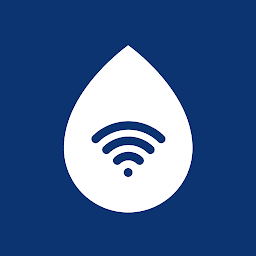
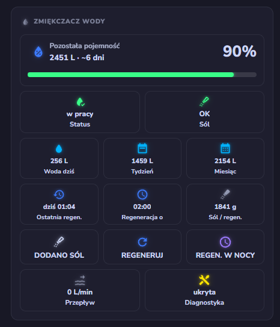

<p align="center">
  
</p>

<h1 align="center">Pentair ConnectMySoftener — Home Assistant</h1>

<p align="center">
  <a href="https://github.com/hacs/integration"></a>
  
  
  <a href="LICENSE"></a>
  <a href="https://buymeacoffee.com/jotuera"></a>
</p>

<p align="center"><a href="https://github.com/jotuera/pentair-connectmysoftener-homeassistant/blob/main/README.md">English</a> · <strong>Polski</strong></p>

Integracja Home Assistant dla zmiękczaczy wody **Pentair ConnectMySoftener**
(dawniej **Erie** — ten sam backend chmurowy `erieapp`, marka przejęta przez Pentair).

Komunikuje się z oficjalnym API chmurowym (`connectmysoftenerapi.pentair.eu`) dokładnie tak
jak aplikacja mobilna — udostępnia sensory do monitorowania oraz encje do sterowania urządzeniem.

> ⚠️ **Integracja nieoficjalna.** Niepowiązana z Pentair / Erie, niewspierana ani
> niezatwierdzona przez te firmy. Odtworzona (reverse engineering) z publicznej aplikacji
> mobilnej do użytku osobistego.

---

## Funkcje

- 📊 Pełny odczyt stanu zmiękczacza: status, pojemność, przepływ i historia
- 🧂 Ostrzeżenie o poziomie soli i alarm niskiego poziomu
- 🔁 Uruchomienie regeneracji (natychmiast albo o zaplanowanej godzinie)
- 🏖️ Włączanie/wyłączanie trybu urlopowego na określoną liczbę dni
- 🌍 Zlokalizowane nazwy encji w **10 językach** (patrz niżej)
- 🧩 Gotowa **karta na dashboard**, serwowana przez integrację (patrz niżej)
- 🏠 **Kilka zmiękczaczy** na jednym koncie — każdy jako osobne urządzenie
- 🔑 Prosi o nowe hasło, gdy zmienisz je w aplikacji (bez ponownego dodawania integracji)
- 🩺 **Diagnostyka** do pobrania, bez danych osobowych
- ☁️ `cloud_polling`, oszczędnie dla chmury: dane na żywo co 90 s, rzadko zmieniające się
  co 10 min (i od razu po każdej akcji), jednostki (l / gal) dobierane automatycznie z konta

## Obsługiwane urządzenia

Integracja nie zależy od modelu zmiękczacza: korzysta z tego samego API chmurowego co
aplikacja **ConnectMySoftener** (dawniej **Erie Connect**). **Jeśli Twój zmiękczacz jest
widoczny i działa w aplikacji ConnectMySoftener, powinien działać także tutaj.** Sama
aplikacja nie ma logiki zależnej od modelu — rozróżnia tylko dwa formaty numeru seryjnego
(`S-########` i `#####-######`), odpowiadające dwóm generacjom sterowników.

### Przetestowane

| Model | Uwagi |
|---|---|
| **Supreme Soft 20W** | Na nim integracja powstała i jest testowana (Pentair / Erie, sprzedawany w Polsce) |

### Powinny działać (ta sama platforma)

| Model / marka | Wi‑Fi | Uwagi |
|---|---|---|
| **Supreme Soft** 11W / 15W / 26W / 32W | wbudowane (W) | Ta sama seria co testowany egzemplarz |
| **Pentair IQ Soft** (IQ Soft 368 EiQ) | wbudowane | Pierwotna seria Erie Connect; wcześniejsze integracje Erie powstały dla **IQsoft 26** |
| **Pentair Softena** (368 EiQ) | opcja | Oznaczony przez Pentair jako „Connected”, sterowany przez ConnectMySoftener |
| **Pentair SlimLine** (368 / 368 EiQ) | opcja | Oznaczony przez Pentair jako „Connected”, sterowany przez ConnectMySoftener |
| Zmiękczacze **Erie** z Wi‑Fi | — | Ten sam backend chmurowy `erieapp` (marka przejęta przez Pentair) |
| Zmiękczacze marki **Van Marcke** | wbudowane od 2022 | Produkowane przez Pentair; to samo API chmurowe |

### Nieobsługiwane

- **Pentair Connected Water Softener (USA)** — zawory Fleck 5800/5810/5812 XTRi; używa
  osobnej aplikacji **Pentair Home** i innej chmury.
- Zmiękczacze bez modułu Wi‑Fi (np. Pentair **Evolio**, **Foleo**, **River Soft**) —
  producent nie podaje dla nich łączności.

Używasz integracji z innym modelem?
[Otwórz zgłoszenie](https://github.com/jotuera/pentair-connectmysoftener-homeassistant/issues)
z informacją, czy działa — dopiszę go do listy.

## Encje

### Sensory
| Encja | Opis |
|--------|-------------|
| Status | `in_service` / `regenerating` / `holiday` / `standby` / `offline` |
| Postęp statusu | Wartość paska postępu (pozostała pojemność w trybie pracy, postęp regeneracji podczas regeneracji) |
| Pozostała pojemność | Pozostała pojemność miękkiej wody (l / gal) |
| Pozostałe dni | Szacowana liczba dni do wyczerpania pojemności |
| Godzina regeneracji | Godzina zaprogramowanej regeneracji (np. `02:00`) — tylko do odczytu, ustawiana na samym urządzeniu |
| Aktualny przepływ | Chwilowy przepływ (l/min lub gal/min) |
| Zużycie całkowite | Całkowita ilość uzdatnionej wody od instalacji |
| Liczba regeneracji | Łączna liczba regeneracji |
| Ostatnia regeneracja | Znacznik czasu ostatniej regeneracji |
| Ostatnia konserwacja | Znacznik czasu ostatniej konserwacji |
| Ostrzeżenia | Liczba aktywnych ostrzeżeń (opisy w atrybutach) |
| Zużyta sól | Sól zużyta podczas ostatniej regeneracji, z historią regeneracji w atrybutach |
| Numer seryjny | Numer seryjny urządzenia *(diagnostyka)* |
| Wersja oprogramowania | Wersja firmware urządzenia *(diagnostyka)* |

### Sensory binarne
| Encja | Klasa urządzenia | Opis |
|--------|--------------|-------------|
| Online | `connectivity` | Urządzenie osiągalne (`status.code != 0`) |
| Ostrzeżenie o soli | `problem` | Aktywne ostrzeżenie o niskim poziomie soli |
| Zmiany oczekujące | — | Ustawienie zostało wysłane, ale urządzenie jeszcze go nie zastosowało |

### Sterowanie
| Encja | Typ | Działanie |
|--------|------|--------|
| Dodano sól | `button` | Potwierdź uzupełnienie soli (kasuje alarm soli) |
| Regeneruj teraz | `button` | Uruchom regenerację natychmiast |
| Regeneruj o zaplanowanej godzinie | `button` | Zakolejkuj regenerację na zaprogramowaną godzinę |
| Tryb urlopowy | `number` (0–40 dni) | `0` = wyłączony, `N` = włączony na N dni |
| Twardość wody | `number` (1–99) | Twardość na wejściu, w jednostce ustawionej na urządzeniu (np. °d) |
| Czas systemowy | `time` | Zegar samego urządzenia — odczytaj, by wykryć rozjechanie, lub ustaw |
| Codzienna regeneracja | `switch` ¹ | Regeneracja codziennie („Uzupełnij codziennie” w aplikacji) |
| Interwał regeneracji | `number` ¹ (0–99 dni) | Wymuszona regeneracja co N dni („Interwał” w aplikacji) |
| Interwał regeneracji (oxy) | `number` ¹ (0–99 dni) | Interwał funkcji oxy, w modelach, które ją mają |
| Powiadomienie o braku soli | `switch` | Powiadomienie z aplikacji/e-mail przy niskim poziomie soli |
| Powiadomienie o konserwacji | `switch` | Powiadomienie z aplikacji/e-mail o wymaganej konserwacji |

¹ Tworzone tylko, gdy urządzenie obsługuje dane ustawienie — integracja czyta te same flagi
funkcji, według których aplikacja pokazuje lub ukrywa pole.

### Zużycie wody (opcjonalne)

Wykres zużycia wody z aplikacji opiera się na endpoincie `/graphs`. Ponieważ wymaga dodatkowych
zapytań do API, jest **domyślnie wyłączony**. Włącz go w
**Ustawienia → Urządzenia i usługi → Pentair ConnectMySoftener → Konfiguruj**
(przełącznik *Pobieraj historię zużycia wody z API*). Pojawią się wtedy cztery dodatkowe
sensory, odpowiadające widokowi Dzień / Tydzień / Miesiąc / Rok z aplikacji:

| Encja | Opis |
|--------|-------------|
| Zużycie wody dziś | Zużycie w bieżącym dniu |
| Zużycie wody w tym tygodniu | Zużycie w bieżącym tygodniu ISO |
| Zużycie wody w tym miesiącu | Zużycie w bieżącym miesiącu |
| Zużycie wody w tym roku | Zużycie w bieżącym roku |

> 💡 Do statystyk długoterminowych i **panelu Woda** w HA kumulacyjny sensor
> `Zużycie całkowite` (`total_increasing`) działa od ręki — dodaj go bezpośrednio albo zbuduj
> liczniki dzienne/miesięczne pomocnikiem `utility_meter`. Powyższe opcjonalne sensory są
> potrzebne tylko wtedy, gdy chcesz dokładnie te liczby, które pokazuje aplikacja.

## Przykłady dla dashboardu

> Poniższe entity_id zakładają domyślną nazwę urządzenia **Pentair Softener**
> (`sensor.pentair_softener_…`). Jeśli profil konta ma własną nazwę urządzenia
> (np. *Supreme Soft20*), Home Assistant zrobi z niej slug
> (`sensor.supreme_soft20_…`) — dostosuj entity_id.
>
> Część po nazwie urządzenia jest zawsze po angielsku (`_total_volume`, `_salt_used`, …)
> niezależnie od języka Home Assistant — tłumaczone są tylko nazwy wyświetlane. Encje
> utworzone przed v0.10.0 mogą nadal mieć przetłumaczone nazwy; zmień ich entity_id
> w ustawieniach encji, aby pasowały do tych przykładów.

### Karta informacyjna

```yaml
type: entities
entities:
  - entity: sensor.pentair_softener_warnings
    name: Ostrzeżenia
  - entity: sensor.pentair_softener_total_volume
    name: Całkowite zużycie wody
    icon: mdi:water
  - entity: sensor.pentair_softener_last_regeneration
    name: Ostatnia regeneracja
    icon: mdi:calendar-clock
  - entity: sensor.pentair_softener_regeneration_count
    name: Liczba regeneracji
    icon: mdi:recycle
  - entity: sensor.pentair_softener_last_maintenance
    name: Ostatni serwis
    icon: mdi:calendar-clock
  - entity: sensor.pentair_softener_days_remaining
    name: Dni do wyczerpania pojemności
    icon: mdi:calendar-clock
```

### Dzienne zużycie wody (ostatnie 7 dni)

Używa [`mini-graph-card`](https://github.com/kalkih/mini-graph-card) (zainstaluj przez HACS
frontend) zasilanej kumulacyjnym sensorem `Zużycie całkowite` — `aggregate_func: sum`
z `group_by: date` zamienia narastającą sumę w słupki dzienne, ten sam trik co w panelu
energii HA.

```yaml
type: custom:mini-graph-card
entities:
  - entity: sensor.pentair_softener_total_volume
    icon: mdi:water
    aggregate_func: sum
    name: Zużycie wody
name: Dzienne zużycie wody (ostatnie 7 dni)
hours_to_show: 168
group_by: date
show:
  graph: bar
  labels: true
color_thresholds:
  - value: 0
    color: "#f5fdff"
  - value: 1
    color: "#3295a8"
```

### Zużycie wody (ostatnie 24 godziny)

Ta sama karta, pogrupowana po godzinach zamiast dniach:

```yaml
type: custom:mini-graph-card
entities:
  - entity: sensor.pentair_softener_total_volume
    aggregate_func: sum
    name: Zużycie wody
name: Zużycie wody z ostatnich 24 godzin
hours_to_show: 24
group_by: hour
hour24: true
show:
  graph: bar
  labels: true
color_thresholds:
  - value: 0
    color: "#f5fdff"
  - value: 1
    color: "#3295a8"
```

### Historia regeneracji

Odtwarza ekran *Historia* z aplikacji. Sensor `Zużyta sól` trzyma ostatnie 20 regeneracji
w atrybucie `history`, więc wystarczy zwykła karta markdown — bez dodatkowych kart.

```yaml
type: markdown
title: Historia regeneracji
content: |-
  | Data | Zużyta sól |
  |---|---|
  
  | {{ as_timestamp(r.datetime, default=0) | timestamp_custom('%d/%m/%Y %H:%M') }} | {{ r.salt_used }} g |
  
```

## Przykład automatyzacji

### Powiadomienie o niskim poziomie soli

```yaml
alias: Niski poziom soli w zmiękczaczu
trigger:
  - platform: state
    entity_id: binary_sensor.pentair_softener_salt_warning
    to: "on"
action:
  - service: notify.mobile_app_your_phone  # podmień na własny cel powiadomień
    data:
      message: "🧂 Niski poziom soli w zmiękczaczu wody"
```

## Instalacja

### HACS (zalecane)

1. W HACS wejdź w **Integracje → ⋮ → Niestandardowe repozytoria**.
2. Dodaj `https://github.com/jotuera/pentair-connectmysoftener-homeassistant` z kategorią **Integration**.
3. Zainstaluj **Pentair ConnectMySoftener**.
4. Zrestartuj Home Assistant.

### Ręcznie

1. Skopiuj `custom_components/pentair_softener` do folderu `config/custom_components/` w Home Assistant.
2. Zrestartuj Home Assistant.

## Konfiguracja

1. **Ustawienia → Urządzenia i usługi → Dodaj integrację → Pentair ConnectMySoftener**.
2. Zaloguj się **tym samym adresem e-mail i hasłem, co w aplikacji ConnectMySoftener**.

Każdy zmiękczacz na koncie jest dodawany jako osobne urządzenie.

**Zmieniłeś hasło w aplikacji?** Home Assistant pokaże *Wymagane ponowne uwierzytelnienie* —
wpisz tam nowe hasło. Hasło możesz też zmienić w dowolnej chwili: **⋮ → Zmień konfigurację**.

**Zgłaszasz problem?** Dołącz plik diagnostyczny: **⋮ → Pobierz diagnostykę**
(e-mail, hasło, numer seryjny i adres są usuwane automatycznie).

**Zapytania do chmury:** dane na żywo (status, przepływ) co 90 s; informacje, ustawienia,
historia i oczekujące zmiany co 10 min oraz od razu po każdej akcji lub zmianie statusu;
wykresy zużycia (opcjonalne) co 30 min.

## Obsługiwane języki

Nazwy encji i okno konfiguracji są przetłumaczone na:
**angielski, polski, niemiecki, francuski, niderlandzki, hiszpański, rumuński, rosyjski, czeski, włoski.**

Tłumaczenia encji pochodzą bezpośrednio z plików językowych oficjalnej aplikacji, tam gdzie są dostępne.

## Karta na dashboard

Integracja dostarcza gotową kartę Lovelace — zmiękczacz w pigułce: pozostała pojemność z paskiem
postępu, status, poziom soli, zużycie wody, ostatnia/następna regeneracja, sól na regenerację,
przepływ, przyciski **Dodano sól / Regeneruj / Regeneracja w nocy** oraz rozwijany panel diagnostyki.

<p align="center">
  
</p>

Karta jest **serwowana przez samą integrację** — nie trzeba ręcznie dodawać zasobu Lovelace.
Dodaj ją na dashboardzie przez **Dodaj kartę → wyszukaj „Pentair"** (ma **edytor graficzny**),
albo w YAML:

```yaml
type: custom:pentair-softener-card
```

Opcje (wszystkie opcjonalne, dostępne też w edytorze graficznym):

| Opcja | Domyślnie | Opis |
|--------|---------|-------------|
| `device` | pierwszy zmiękczacz | ID urządzenia — wybierz jeden zmiękczacz, gdy masz kilka na koncie |
| `title` | zlokalizowany | Własny tekst nagłówka |
| `confirm` | `true` | Pytaj przed **Regeneruj** / **Regeneracja w nocy** (potwierdzenie dwoma kliknięciami) |
| `buttons` | `true` | Pokaż przyciski akcji |
| `usage` | `true` | Pokaż kafelki zużycia wody |
| `diagnostics` | `true` | Pokaż przełącznik diagnostyki |

Karta sama znajduje encje integracji (po platformie i kluczu tłumaczenia), więc wystarczy
powyższa linijka. Kafelki zużycia wody pojawiają się, gdy włączone są opcjonalne sensory
zużycia; kafelki brakujących encji są chowane automatycznie.

Więcej funkcji:

- **Potwierdzenie dwoma kliknięciami** przy *Regeneruj* / *Regeneracja w nocy* — pierwsze
  kliknięcie uzbraja przycisk (*Na pewno?*), drugie potwierdza; wraca po kilku sekundach.
  *Dodano sól* działa od razu.
- **Historia regeneracji** — rozwijany panel *Historia* (data / sól / %), odpowiednik ekranu
  Historia z aplikacji, gdy sensor `Zużyta sól` niesie atrybut historii.
- **Nagłówek zależny od stanu** — podczas regeneracji pokazuje jej postęp i pozostały czas,
  w trybie urlopowym liczbę dni, a przy ostrzeżeniu urządzenia — **pasek ostrzeżenia**
  (niski poziom soli, zalecany serwis…).
- Dotknij dowolny kafelek, aby otworzyć okno „więcej informacji" jego encji.

Karta podąża za językiem Home Assistant — angielski jest źródłem, z wbudowanymi tłumaczeniami
na **polski, niemiecki, francuski, niderlandzki, hiszpański, włoski, rumuński, rosyjski i
czeski** (9 języków). Jednostki (l / gal, g, l/min) pochodzą wprost z encji, więc konta w
systemie amerykańskim i metrycznym są obsługiwane automatycznie.

> Jeśli wolisz zarządzać kartą samodzielnie, plik jest też dostępny jako zasób Lovelace pod
> `/pentair_softener/pentair-softener-card.js`. Zasób dodany tam ręcznie (np. nowsza kopia)
> ma pierwszeństwo nad wersją wbudowaną.

## Ikona w interfejsie

Od Home Assistant 2026.3.0 ikona jest dołączona lokalnie w
`custom_components/pentair_softener/brand/` (`icon.png` / `icon@2x.png`) i jest wykrywana
automatycznie — bez dodatkowej konfiguracji i bez zgłaszania do
[home-assistant/brands](https://github.com/home-assistant/brands) (to repozytorium nie
przyjmuje już ikon integracji niestandardowych, zob.
[ogłoszenie](https://developers.home-assistant.io/blog/2026/02/24/brands-proxy-api)).

## Autorzy

- Autor: **JoTu** — [github.com/jotuera](https://github.com/jotuera)
- Napisane od zera przez odtworzenie (reverse engineering) API chmurowego aplikacji ConnectMySoftener.

## Wsparcie

Jeśli ta integracja jest dla Ciebie przydatna, rozważ wsparcie mnie kawą. Dziękuję!

<a href="https://buymeacoffee.com/jotuera"></a>

## Licencja

Udostępnione na [licencji MIT](LICENSE) © 2026 JoTu.

## Zastrzeżenie

Korzysta z nieudokumentowanego API chmurowego, które może się zmienić lub przestać działać
w dowolnym momencie. Znaki towarowe, nazwy produktów i logo należą do Pentair / Erie i są
użyte wyłącznie do identyfikacji urządzenia. Dostarczane „tak jak jest", bez żadnej gwarancji.
